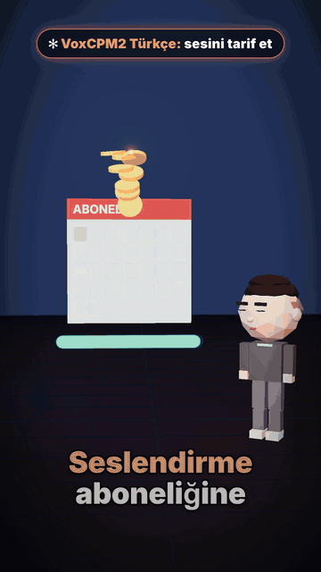
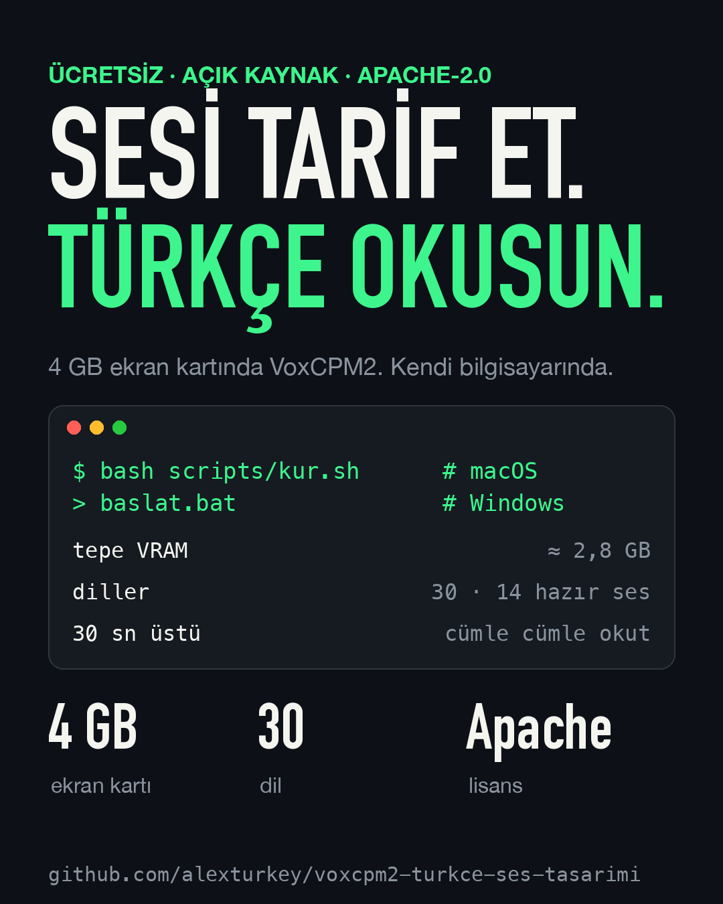

# 4 GB ekran kartında Türkçe ses tasarımı. Ücretsiz, kendi bilgisayarınızda.

2,8 GB. Bu araçla Türkçe ses üretmenin tepe görüntü belleği bu kadar.

VoxCPM2 Türkçe ses tasarımı.

Seslendirme aboneliğine her ay ödüyorsun, kota ayın ortasında bitiyor; ücretsiz seslerin Türkçesi de robot gibi.

Bu açık kaynak araç, VoxCPM2 modelini 4 GB'lık ekran kartına sığdırıyor:
→ sesi İngilizce tarif ediyorsun, model birkaç varyant çıkarıyor
→ beğendiğini seçip istediğin Türkçe metni o sesle okutuyorsun
→ 30 dilde okuyor, 14 hazır sesle geliyor
→ arayüz kendi bilgisayarında, tarayıcıda açılıyor
→ Windows ve Apple Silicon Mac; Linux deneysel; model ~3 GB

Benim videolarımdaki anlatıcı ses de VoxCPM2 ile üretiliyor (başka bir kurulumla). Bu yüzden şunu biliyorum: metni cümle cümle okutunca çok daha temiz çıkıyor.

**📊 Rakamlarla:**
• 4 GB ekran kartı
• 30 dil
• Apache lisans

**⚙️ Nasıl başlarsın:**
$ bash scripts/kur.sh      # macOS
> baslat.bat               # Windows

**📌 Kısa notlar:**
• tepe VRAM: ≈ 2,8 GB
• diller: 30 · 14 hazır ses
• 30 sn üstü: cümle cümle okut

**✨ Öne çıkanlar:**
• sesi kelimelerle tarif ediyorsun
• 30 dil, 14 hazır ses
• arayüz kendi bilgisayarında

Yerel TTS'e geçtiniz mi, yoksa hâlâ abonelik mi?

[▶ Tam kalite video: video.mp4](video.mp4)

## Videoda adım adım

1. 4 GB ekran kartında çalışan, VoxCPM2 tabanlı ücretsiz bir Türkçe ses tasarım aracı çıktı.
2. Sesi İngilizce tarif ediyorsun, model birkaç varyant çıkarıyor ve beğendiğini saklıyorsun.
3. Sonra istediğin Türkçe metni o sesle okutuyorsun.
4. Uygulama 30 dilde okuyabiliyor ve 14 hazır sesle geliyor.
5. Geliştiricinin ölçümüne göre en yüksek görüntü belleği 2,8 GB.
6. Windows ve Apple Silicon Mac'lerde çalışıyor, Linux desteği deneysel ve model yaklaşık 3 GB.
7. Dikkat, 30 saniyeden uzun tek parça üretimde model kararsızlaşıyor, metni cümle cümle okutmak gerekiyor.
8. Eski bir kartta bir saniyelik ses yaklaşık iki saniyede çıkıyor ve klonlama yalnız izinli seslerle yapılmalı.

## Kaynak

- https://github.com/alexturkey/voxcpm2-turkce-ses-tasarimi

## Lisans

Bu depodaki video, kart ve metinler MIT lisanslıdır (LICENSE). Anlatılan aracın kendi lisansı kendi deposundadır.
